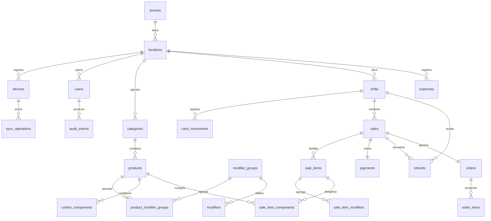

# Diseño de modelo de datos — Caja v1

**Fecha:** 2026-11-06
**Estado:** borrador para aprobación.
**Contexto:** `Panteamiento del proyecto.md`, `docs/requisitos-v1.md`, `docs/superpowers/plans/2026-11-05-caja-v1-pwa.md`.
**Enfoque elegido:** relacional normalizado.

---

## 1. Intención y por qué

Caja v1 necesita un esquema que soporte la operación real de una sede —venta, turno, devolución, gasto y reporte— y que después evolucione hacia la plataforma multicanal sin reescribir el núcleo. El modelo debe ser lo bastante estricto para que la sincronización offline no duplique ventas ni pierda datos, y lo bastante simple para que la primera versión sea estable.

Este documento define el **modelo físico de datos** del backend: tablas, columnas clave, relaciones, índices y reglas de integridad. No define pantallas, endpoints ni algoritmos de sincronización; eso queda en el plan de implementación.

---

## 2. Objetivos, no objetivos y anti-goals

### Objetivos

- Representar la operación de caja de una sede con precisión contable.
- Garantizar aislamiento por tenant y sede en cada tabla operativa.
- Soportar sincronización offline idempotente y ordenada.
- Conservar historial auditable sin edición ni borrado.
- Calcular reportes del día y de rangos sin duplicar datos.
- Dejar el camino abierto a pedidos de Rappi/DiDi en fase 2.

### No objetivos

- Modelar inventario, compras, nómina o contabilidad formal.
- Modelar cuentas abiertas por mesa.
- Modelar tareas por estación o tablero operacional.
- Optimizar consultas analíticas de alto volumen.

### Anti-goals

- Un esquema que obligue a reescribir ventas al agregar un canal nuevo.
- Un esquema que permita dos verdades del mismo pedido.
- Un esquema que pierda el histórico al desactivar un producto o usuario.
- Un esquema que use `float` o `double` para dinero.

---

## 3. Restricciones duras

1. **Dinero en enteros.** Todas las columnas monetarias son `bigint` y terminan en `_pesos`.
2. **Aislamiento.** Toda tabla operativa lleva `tenant_id` y `location_id`. El servidor deriva el tenant del token, nunca del cuerpo del request.
3. **Offline-first.** Toda venta nace local y llega por `/api/sync/operations`; no hay endpoint directo de creación de ventas.
4. **Idempotencia.** `sync_operations` usa `operation_id` como clave y `(device_id, seq)` como unicidad de orden.
5. **Código visible.** `sales.display_code` es único por tenant y usa el formato `LOCALIDAD-DISPOSITIVO-SECUENCIA`.
6. **Turno.** Un solo turno abierto por sede y dispositivo.
7. **Auditoría.** `audit_events` es append-only: sin `UPDATE` ni `DELETE` desde la aplicación.
8. **Retención.** Ventas y auditoría se conservan mínimo 5 años; no hay borrado automático en v1.
9. **Zona horaria.** Los timestamps son `timestamptz` en UTC; el día operativo se calcula en `America/Bogota` y se guarda como `date` en `operational_date`.
10. **Catálogo por sede.** Productos, categorías y modificadores pertenecen a una sede, no a un tenant global.

---

## 4. Enfoques considerados

### Relacional normalizado *(elegido)*

Tablas por módulo, claves foráneas explícitas, auditoría append-only y `sync_operations` como registro operativo.

**Por qué:** cumple las reglas de negocio sin complejidad extra, permite validar integridad en la base y deja añadir canales nuevos con tablas adicionales en vez de reescribir las existentes.

### Event sourcing

Todo queda como eventos y las tablas actuales son proyecciones.

**Por qué no:** maximiza trazabilidad, pero v1 no lo necesita y complica consultas, reportes y depuración. La auditoría append-only ya cubre el rastro necesario.

### Desnormalizado orientado a reportes

Tablas anchas con datos duplicados para acelerar reportes.

**Por qué no:** reduce joins, pero crea varias verdades del mismo dato y hace difícil garantizar consistencia tras sincronización y devoluciones.

---

## 5. Convenciones globales

- **Claves primarias:** `id uuid` generado por el servidor o por el cliente según la tabla.
- **Claves foráneas:** siempre explícitas, con `ON DELETE RESTRICT` por defecto.
- **Dinero:** `bigint`, sufijo `_pesos`, sin `float`, `double` ni `numeric`.
- **Timestamps:** `created_at timestamptz not null`; las tablas mutables añaden `updated_at timestamptz`.
- **Día operativo:** `operational_date date not null`, calculado en Bogotá al crear la operación.
- **Borrado:** no hay borrado lógico general. Se usa `active boolean` en usuarios, productos, categorías y modificadores.
- **Auditoría:** solo insert; la base debe impedir `UPDATE` y `DELETE` desde la aplicación.
- **Catálogo:** la versión vive en `locations.catalog_version`; no hay tabla de snapshots. La API arma el snapshot desde las tablas actuales en una transacción.
- **Marca:** no hay tabla `brands` en v1. Karbón es la única marca de la sede piloto. La marca se modela cuando haya más de una.
- **`Pesos`:** es un value object en código, no una tabla. La base solo ve `bigint`.

---

## 6. Diagrama general

---

## 7. Tablas por módulo

### 7.1 Tenancy

#### `tenants`

- **Propósito:** restaurante o empresa dueña de las sedes.
- **Columnas clave:** `id uuid pk`, `name varchar(100) not null`, `created_at`.
- **Reglas:** raíz del aislamiento. No lleva `tenant_id` porque es el tenant.

#### `locations`

- **Propósito:** sede física (Almendros, Calipso, Caney).
- **Columnas clave:** `id uuid pk`, `tenant_id uuid fk tenants`, `code varchar(8) not null`, `name varchar(100) not null`, `catalog_version bigint not null default 1`, `created_at`.
- **Restricciones:** `unique(tenant_id, code)`. Ejemplo: `ALM`.
- **Reglas:** `catalog_version` se incrementa en cada cambio de catálogo. El snapshot se sirve desde las tablas actuales, no desde una copia.

---

### 7.2 Identidad

#### `users`

- **Propósito:** persona que opera o administra.
- **Columnas clave:** `id uuid pk`, `tenant_id uuid fk tenants`, `location_id uuid fk locations`, `username varchar(50) not null`, `password_hash varchar(100) not null`, `role enum('CASHIER','MANAGER','ADMIN') not null`, `active boolean not null default true`, `refresh_token_hash varchar(100)`, `refresh_token_expires_at timestamptz`, `created_at`, `updated_at`.
- **Restricciones:** `unique(tenant_id, username)`.
- **Reglas:** un usuario desactivado no puede iniciar sesión. El PIN offline no se guarda aquí; es un dato local del dispositivo. En v1 un usuario pertenece a una sede; si en fase 2 un usuario opera varias sedes, se crea `user_locations`.

#### `devices`

- **Propósito:** PC o tablet registrada en una sede.
- **Columnas clave:** `id uuid pk`, `tenant_id uuid fk tenants`, `location_id uuid fk locations`, `code varchar(8) not null`, `name varchar(100) not null`, `token_hash varchar(100) not null`, `status enum('ACTIVE','REVOKED') not null`, `registered_at timestamptz not null`, `last_seen_at timestamptz`.
- **Restricciones:** `unique(location_id, code)`.
- **Reglas:** `token_hash` es SHA-256 del token opaco; nunca se guarda el token en claro. Un dispositivo revocado no sincroniza. Si se pierde el almacenamiento local, se revoca el dispositivo y se registra uno nuevo con código distinto; así la secuencia de `display_code` puede empezar en 1 sin colisionar con el histórico.

---

### 7.3 Catálogo

#### `categories`

- **Propósito:** agrupación visible de productos.
- **Columnas clave:** `id uuid pk`, `tenant_id uuid fk tenants`, `location_id uuid fk locations`, `name varchar(100) not null`, `sort_order int not null default 0`, `active boolean not null default true`, `created_at`, `updated_at`.
- **Restricciones:** `unique(location_id, name)`.

#### `products`

- **Propósito:** producto vendible o combo.
- **Columnas clave:** `id uuid pk`, `tenant_id uuid fk tenants`, `location_id uuid fk locations`, `category_id uuid fk categories`, `kind enum('PRODUCT','COMBO') not null`, `name varchar(100) not null`, `price_pesos bigint not null`, `cost_pesos bigint`, `sort_order int not null default 0`, `active boolean not null default true`, `created_at`, `updated_at`.
- **Restricciones:** `price_pesos >= 0`, `cost_pesos is null or cost_pesos >= 0`, `unique(location_id, name)`.
- **Reglas:** `cost_pesos` puede ser nulo; el reporte de utilidad lo trata como 0 y advierte.

#### `modifier_groups`

- **Propósito:** grupo de modificadores con reglas de selección.
- **Columnas clave:** `id uuid pk`, `tenant_id uuid fk tenants`, `location_id uuid fk locations`, `name varchar(100) not null`, `min_selection int not null default 0`, `max_selection int not null default 1`, `active boolean not null default true`, `created_at`, `updated_at`.
- **Restricciones:** `min_selection >= 0`, `max_selection >= min_selection`, `unique(location_id, name)`.

#### `modifiers`

- **Propósito:** opción dentro de un grupo.
- **Columnas clave:** `id uuid pk`, `tenant_id uuid fk tenants`, `location_id uuid fk locations`, `modifier_group_id uuid fk modifier_groups`, `name varchar(100) not null`, `additional_price_pesos bigint not null default 0`, `active boolean not null default true`, `created_at`, `updated_at`.
- **Restricciones:** `additional_price_pesos >= 0`, `unique(modifier_group_id, name)`.

#### `product_modifier_groups`

- **Propósito:** relación producto–grupo de modificadores.
- **Columnas clave:** `product_id uuid fk products`, `modifier_group_id uuid fk modifier_groups`, `tenant_id uuid fk tenants`, `location_id uuid fk locations`.
- **Restricciones:** `primary key(product_id, modifier_group_id)`.
- **Reglas:** las reglas de mínimo y máximo viven en `modifier_groups`; no se sobrescriben por producto.

#### `combo_components`

- **Propósito:** componentes de un combo.
- **Columnas clave:** `combo_product_id uuid fk products`, `component_product_id uuid fk products`, `quantity int not null`, `tenant_id uuid fk tenants`, `location_id uuid fk locations`.
- **Restricciones:** `primary key(combo_product_id, component_product_id)`, `quantity > 0`.
- **Reglas:** `combo_product_id` debe apuntar a un producto con `kind = 'COMBO'`.

---

### 7.4 Ventas

#### `sales`

- **Propósito:** venta confirmada en caja.
- **Columnas clave:**
  - `id uuid pk`
  - `tenant_id uuid fk tenants`
  - `location_id uuid fk locations`
  - `device_id uuid fk devices`
  - `user_id uuid fk users`
  - `shift_id uuid fk shifts`
  - `type enum('COUNTER','DELIVERY','DINE_IN') not null`
  - `table_label varchar(20)`
  - `delivery_fee_pesos bigint not null default 0`
  - `total_pesos bigint not null`
  - `status enum('CHARGED','REFUNDED') not null default 'CHARGED'`
  - `display_code varchar(20) not null`
  - `device_seq bigint not null`
  - `operational_date date not null`
  - `client_created_at timestamptz not null`
  - `server_received_at timestamptz`
  - `created_at`
- **Restricciones:** `total_pesos >= 0`, `delivery_fee_pesos >= 0`, `unique(tenant_id, display_code)`, `unique(device_id, device_seq)`.
- **Reglas:** el código visible usa `LOCALIDAD-DISPOSITIVO-SECUENCIA` (ej. `ALM-A-000123`). `device_seq` es la secuencia local del dispositivo; el servidor la acepta y garantiza unicidad. `table_label` solo aplica cuando `type = 'DINE_IN'`. `delivery_fee_pesos` solo aplica cuando `type = 'DELIVERY'`.

#### `sale_items`

- **Propósito:** línea de la venta.
- **Columnas clave:** `id uuid pk`, `tenant_id uuid fk tenants`, `location_id uuid fk locations`, `sale_id uuid fk sales`, `product_id uuid fk products`, `product_name varchar(100) not null`, `category_name varchar(100) not null`, `quantity int not null`, `unit_price_pesos bigint not null`, `cost_pesos bigint`, `note varchar(200)`, `line_total_pesos bigint not null`, `created_at`.
- **Restricciones:** `quantity between 1 and 99`, `unit_price_pesos >= 0`, `cost_pesos is null or cost_pesos >= 0`, `line_total_pesos >= 0`.
- **Reglas:** `product_name`, `category_name`, `unit_price_pesos` y `cost_pesos` se congelan al vender. El servidor guarda los valores enviados por la caja y **no** los recalcula desde el catálogo vigente; esto cumple RF-SALE-12 y CA-E2E-10. `line_total_pesos = quantity × (unit_price_pesos + suma de additional_price_pesos de sus modificadores)`.

#### `sale_item_modifiers`

- **Propósito:** modificadores elegidos en una línea.
- **Columnas clave:** `sale_item_id uuid fk sale_items`, `modifier_id uuid fk modifiers`, `modifier_name varchar(100) not null`, `additional_price_pesos bigint not null`, `tenant_id uuid fk tenants`, `location_id uuid fk locations`.
- **Restricciones:** `primary key(sale_item_id, modifier_id)`, `additional_price_pesos >= 0`.
- **Reglas:** también congela nombre y precio del modificador. El precio adicional se cobra **por unidad**, no por línea.

#### `sale_item_components`

- **Propósito:** componentes de una línea cuyo producto es un combo.
- **Columnas clave:** `sale_item_id uuid fk sale_items`, `component_product_id uuid fk products`, `component_name varchar(100) not null`, `quantity int not null`, `tenant_id uuid fk tenants`, `location_id uuid fk locations`.
- **Restricciones:** `primary key(sale_item_id, component_product_id)`, `quantity > 0`.
- **Reglas:** solo se llena cuando la línea corresponde a un producto con `kind = 'COMBO'`. Congela nombres y cantidades de los componentes; el precio del combo ya está en `sale_items.unit_price_pesos`.

#### `payments`

- **Propósito:** medio de pago de la venta.
- **Columnas clave:** `id uuid pk`, `tenant_id uuid fk tenants`, `location_id uuid fk locations`, `sale_id uuid fk sales`, `method enum('CASH','CARD','BREB') not null`, `amount_pesos bigint not null`, `created_at`.
- **Restricciones:** `amount_pesos >= 0`, `unique(sale_id)`.
- **Reglas:** en v1 hay un solo pago por venta. La unicidad se relaja si en el futuro se permiten pagos divididos.

---

### 7.5 Turnos y caja

#### `shifts`

- **Propósito:** turno de caja entre apertura y cierre.
- **Columnas clave:**
  - `id uuid pk`
  - `tenant_id uuid fk tenants`
  - `location_id uuid fk locations`
  - `device_id uuid fk devices`
  - `user_id uuid fk users`
  - `opening_cash_pesos bigint not null`
  - `opened_at timestamptz not null`
  - `closed_at timestamptz`
  - `counted_cash_pesos bigint`
  - `expected_local_pesos bigint`
  - `expected_server_pesos bigint`
  - `difference_pesos bigint`
  - `operational_date date not null`
  - `created_at`
  - `updated_at`
- **Restricciones:** `opening_cash_pesos >= 0`, `unique(location_id, device_id) where closed_at is null`.
- **Reglas:** un dispositivo no puede tener dos turnos abiertos. El servidor recalcula el esperado y guarda ambos cálculos; la diferencia se marca, no se corrige en silencio.

#### `cash_movements`

- **Propósito:** ingreso o retiro de efectivo durante el turno.
- **Columnas clave:** `id uuid pk`, `tenant_id uuid fk tenants`, `location_id uuid fk locations`, `shift_id uuid fk shifts`, `user_id uuid fk users`, `type enum('DEPOSIT','WITHDRAWAL') not null`, `amount_pesos bigint not null`, `reason varchar(200) not null`, `operational_date date not null`, `created_at`.
- **Restricciones:** `amount_pesos > 0`.

#### `refunds`

- **Propósito:** devolución de una venta.
- **Columnas clave:** `id uuid pk`, `tenant_id uuid fk tenants`, `location_id uuid fk locations`, `sale_id uuid fk sales`, `shift_id uuid fk shifts`, `device_id uuid fk devices`, `user_id uuid fk users`, `reason varchar(200) not null`, `amount_pesos bigint not null`, `method enum('CASH','CARD','BREB') not null`, `operational_date date not null`, `created_at`.
- **Restricciones:** `amount_pesos = sale.total_pesos`, `unique(sale_id)`.
- **Reglas:** la devolución pertenece al turno abierto en el momento de devolver, no al turno de la venta original; esto cumple CA-REF-02 y CA-REF-03. `shift_id` y `device_id` identifican ese turno. En v1 solo se permiten devoluciones completas, no parciales.

#### `expenses`

- **Propósito:** gasto operativo registrado en línea.
- **Columnas clave:** `id uuid pk`, `tenant_id uuid fk tenants`, `location_id uuid fk locations`, `user_id uuid fk users`, `category varchar(100) not null`, `description varchar(200) not null`, `amount_pesos bigint not null`, `expense_date date not null`, `created_at`.
- **Restricciones:** `amount_pesos > 0`.
- **Reglas:** requiere conexión y rol `MANAGER` o `ADMIN`.

---

### 7.6 Pedidos

#### `orders`

- **Propósito:** pedido canónico independiente del canal.
- **Columnas clave:** `id uuid pk`, `tenant_id uuid fk tenants`, `location_id uuid fk locations`, `sale_id uuid fk sales`, `source enum('CAJA','RAPPI','DIDI') not null`, `external_ref varchar(100)`, `status enum('CHARGED','REFUNDED') not null`, `operational_date date not null`, `created_at`.
- **Restricciones:** `unique(sale_id)`.
- **Reglas:** en v1 cada venta genera un pedido 1:1 con `source = 'CAJA'`. `external_ref` queda nulo hasta que existan integraciones.

#### `order_items`

- **Propósito:** proyección de los ítems del pedido.
- **Columnas clave:** `id uuid pk`, `tenant_id uuid fk tenants`, `location_id uuid fk locations`, `order_id uuid fk orders`, `product_id uuid fk products`, `product_name varchar(100) not null`, `quantity int not null`, `unit_price_pesos bigint not null`, `note varchar(200)`, `created_at`.
- **Restricciones:** `quantity between 1 and 99`.
- **Reglas:** en v1 se copia desde `sale_items`. La duplicación es deliberada: en fase 2 los pedidos de Rappi/DiDi no tendrán una venta local y necesitarán su propia lista de ítems.

---

### 7.7 Sincronización

#### `sync_operations`

- **Propósito:** registro del resultado de cada operación sincronizada.
- **Columnas clave:**
  - `operation_id uuid pk`
  - `tenant_id uuid fk tenants`
  - `location_id uuid fk locations`
  - `device_id uuid fk devices`
  - `user_id uuid fk users`
  - `seq bigint not null`
  - `type enum('CREATE_SALE','REFUND_SALE','OPEN_SHIFT','CASH_MOVEMENT','CLOSE_SHIFT') not null`
  - `entity_id uuid`
  - `payload_hash varchar(64) not null`
  - `result_json jsonb`
  - `client_created_at timestamptz not null`
  - `server_received_at timestamptz not null`
  - `applied_at timestamptz`
  - `clock_skew boolean not null default false`
- **Restricciones:** `unique(device_id, seq)`, `seq > 0`.
- **Reglas:** si llega un `operation_id` repetido con el mismo `payload_hash`, se devuelve `DUPLICATE` y el resultado guardado. Si el hash difiere, se rechaza. Si falta un `seq` anterior, el lote devuelve `RETRY` y no aplica nada. `clock_skew` se marca cuando la diferencia entre `client_created_at` y `server_received_at` supera 5 minutos; la operación se acepta, no se rechaza. La tabla guarda el desenlace; la cola local vive en IndexedDB.

---

### 7.8 Auditoría

#### `audit_events`

- **Propósito:** rastro append-only de acciones relevantes.
- **Columnas clave:** `id uuid pk`, `tenant_id uuid fk tenants`, `location_id uuid fk locations`, `user_id uuid fk users`, `event_type varchar(50) not null`, `entity_type varchar(50) not null`, `entity_id uuid`, `payload_json jsonb`, `created_at timestamptz not null`.
- **Reglas:** solo `INSERT`. La aplicación nunca actualiza ni borra. Los eventos incluyen, como mínimo: venta creada, devolución, apertura y cierre de turno, movimiento de caja, gasto registrado y cambios de catálogo.

---

## 8. Índices y consultas críticas

- `sales`: `(tenant_id, location_id, operational_date)`, `(shift_id)`, `(display_code)`.
- `sale_items`: `(sale_id)`, `(product_id)`.
- `sale_item_modifiers`: `(sale_item_id)`.
- `sale_item_components`: `(sale_item_id)`, `(component_product_id)`.
- `payments`: `(sale_id)`.
- `refunds`: `(sale_id)`, `(shift_id)`, `(tenant_id, location_id, operational_date)`.
- `shifts`: `(tenant_id, location_id, operational_date)`, índice parcial único de turno abierto por dispositivo.
- `cash_movements`: `(shift_id)`.
- `expenses`: `(tenant_id, location_id, expense_date)`.
- `orders`: `(sale_id)`, `(tenant_id, location_id, operational_date)`.
- `sync_operations`: `(device_id, seq)`, `(tenant_id, location_id, applied_at)`.
- `audit_events`: `(tenant_id, location_id, created_at)`, `(entity_type, entity_id)`.
- `products`: `(location_id, category_id, active)`.
- `users`: `(tenant_id, username)`.
- `devices`: `(location_id, code)`.

Toda consulta de negocio filtra por `tenant_id` y, cuando aplica, `location_id`. No existe `findAll()` sin filtro.

---

## 9. Reglas de integridad transversal

1. **Idempotencia:** la unicidad de `operation_id` y `(device_id, seq)` evita duplicados y huecos.
2. **Orden:** el servidor solo aplica `seq = last_seq + 1`; un hueco detiene el lote.
3. **Atomicidad local:** la caja escribe venta y operación pendiente en una sola transacción de IndexedDB; el servidor refleja lo mismo en una transacción de PostgreSQL.
4. **Aislamiento:** el tenant y la sede se derivan del token o del dispositivo, nunca del payload del cliente. Además, las claves foráneas cruzando entidades usan claves compuestas —por ejemplo, `sales(location_id, tenant_id)` referencia `locations(id, tenant_id)`— para que la base misma impida mezclar sedes o tenants.
5. **Historial:** precios, nombres, costos, categorías y componentes se congelan en `sale_items`, `sale_item_modifiers` y `sale_item_components`.
6. **Turno:** la venta exige `shift_id` de un turno abierto del mismo dispositivo.
7. **Devolución:** pertenece al turno abierto al momento de devolver y se registra en su propia fecha; no reescribe la venta original.
8. **Auditoría:** todo cambio sensible produce un evento append-only con usuario y fecha.
9. **Estado de devolución:** la fila en `refunds` es la fuente de verdad. `sales.status` y `orders.status` se mantienen en la misma transacción como proyección para consultar rápido, pero no son la fuente.

---

## 10. Mapeo hacia el plan de implementación

- **Tarea 2:** crea `tenants`, `locations`, `users`, `devices`, `sync_operations`, `audit_events` y el tipo `Pesos`.
- **Tarea 3:** usa `users` y `devices` para login, refresh y registro de dispositivos.
- **Tarea 4:** usa `categories`, `products`, `modifier_groups`, `modifiers`, `product_modifier_groups`, `combo_components` y la versión de catálogo.
- **Tarea 5:** usa `sales`, `sale_items`, `sale_item_modifiers`, `sale_item_components`, `payments`, `shifts`, `cash_movements`, `refunds`, `orders` y `order_items`.
- **Tarea 6:** usa `sync_operations` para idempotencia y orden.
- **Tarea 7:** usa `expenses`, `refunds`, `sales` y `audit_events` para reportes y auditoría.
- **Tareas 9–14:** replican en IndexedDB los conceptos necesarios para operar offline; el esquema local no es una copia exacta de estas tablas.

---

## 11. Decisiones propuestas que puedes cambiar

1. **`users.location_id` obligatorio en v1.** Simplifica el aislamiento mientras hay una sola sede. Si un usuario debe operar en varias sedes, se introduce `user_locations` en fase 2.
2. **Un solo pago por venta.** `payments` tiene `unique(sale_id)`. Si se permiten pagos divididos, se elimina la restricción con una migración.
3. **Solo devoluciones completas.** `refunds` exige `amount_pesos = sale.total_pesos` y `unique(sale_id)`. Si en el futuro se permiten parciales, se elimina la igualdad y se ajusta el arqueo.
4. **`order_items` duplica `sale_items`.** Es redundante en v1, pero deja a `orders` independiente del canal para fase 2.
5. **No hay tabla de snapshots de catálogo.** El snapshot se compone desde las tablas actuales y la versión vive en `locations.catalog_version`.
6. **No hay tabla `brands`.** Karbón es la única marca en v1. La marca se modela cuando exista más de una.
7. **`refresh_token_hash` vive en `users`.** Asume una sesión activa por usuario en v1. Si se necesitan múltiples sesiones, se crea `refresh_tokens`.
8. **`sync_operations` guarda el desenlace, no la cola.** La cola pendiente vive en IndexedDB; el servidor solo registra lo aplicado.
9. **Se congelan nombre, categoría, precio, costo y componentes en la venta.** Esto hace que los reportes históricos no cambien cuando el catálogo cambia.
10. **Las claves foráneas cruzando entidades son compuestas.** La base de datos, no solo la aplicación, impide mezclar tenant o sede.
11. **El modificador se cobra por unidad.** `line_total_pesos = quantity × (unit_price_pesos + Σ additional_price_pesos)`.
12. **Re-provisionar un dispositivo genera un código nuevo.** El dispositivo anterior queda revocado y conservado; el nuevo empieza su secuencia en 1 sin colisionar con el histórico.

---

## 12. Preguntas abiertas

Ninguna. Las tres que faltaban ya fueron resueltas: modificadores por unidad, solo devoluciones completas y código nuevo al re-provisionar un dispositivo.
